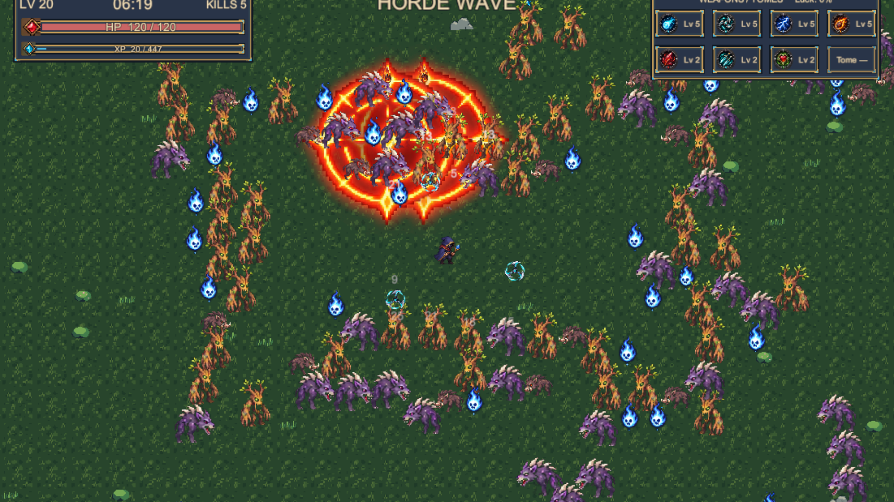
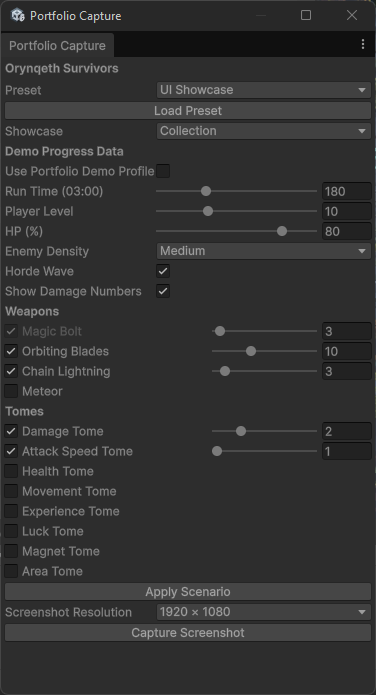
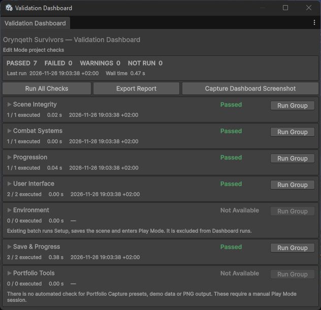

# Orynqeth Survivors

**A dark-fantasy survival game — and a technical game design case study.**

**[Explore the interactive portfolio case study](https://mralexblack.github.io/orynqeth-survivors-portfolio/)**

## About the project

Orynqeth Survivors is an independent, top-down 2D survival prototype made with **Unity 6, C#, and URP 2D**. Players survive escalating waves of enemies, develop weapon combinations, select upgrades of different rarities, and unlock new equipment across runs. Its target run lasts ten minutes.

This project was developed as a portfolio case for **Technical Game Design / Tools Design**, with a focus on designing interconnected gameplay systems, building useful editor workflows, and iterating quickly through AI-assisted development.

## Highlights

| Game systems | Development tools |
| --- | --- |
| Four distinct weapons with different combat roles | **Portfolio Capture**: scenario presets, progression configuration, and Game View capture |
| Three upgrade choices per level, influenced by rarity and Luck | **Validation Dashboard**: grouped checks, status reporting, and report export |
| Passive tomes and persistent unlockable collection | **Environment Settings**: data-driven procedural forest generation |
| Increasing enemy pressure and periodic horde waves | Targeted checks for UI, progression, pooling, and saved progress |

### Inside Unity

| Portfolio Capture | Validation Dashboard |
| :---: | :---: |
|  |  |

## My role and approach

**Oleksandr Soshyn — Game & Technical Designer**

- Defined weapon behavior, upgrade offers, Luck and rarity rules, passive progression, and unlock conditions.
- Designed specifications and acceptance criteria for custom Unity Editor tools.
- Reviewed combat outcomes and iterated on weapon balance and enemy-wave pacing.
- Directed visual integration, reported regressions, and checked UI and gameplay behavior across iterations.

**AI-assisted development disclosure:** A substantial portion of the C# implementation and visual assets was created with AI tools under my direction. My responsibilities centered on system design, specifications, balancing, tool workflows, review, and validation — not writing every line of code manually.

## Selected technical decisions

- **Repeatable scenarios:** The Portfolio Capture tool can configure early-game, progression, horde, late-game, and UI-showcase states without replaying an entire run.
- **Safe validation:** The dashboard separates checks it can run in Edit Mode from checks requiring potentially state-changing operations or manual Play Mode verification. Unavailable checks are not misrepresented as passes.
- **Procedural environment:** Deterministic generation and reusable chunks keep the forest continuous while allowing environment settings to be tuned as data.
- **Balance iteration:** Damage breakdowns exposed an overperforming Meteor weapon; other weapon options and the starting Magic Bolt were adjusted. Horde waves were introduced to make pacing less uniform.

## Technology

`Unity 6` · `C#` · `URP 2D` · `ScriptableObjects` · `Unity Editor tooling` · `AI-assisted development`

## View the full case study

The **[portfolio website](https://mralexblack.github.io/orynqeth-survivors-portfolio/)** includes gameplay screenshots, editor tool captures, the design rationale, implementation decisions, and key iteration challenges.

> **Repository scope:** This repository contains the static portfolio website (HTML, CSS, JavaScript, and images), **not the Unity game's source project**. A public downloadable Windows build and gameplay video have not yet been linked here.
>
> Collection and Statistics images on the website use a temporary **portfolio demo profile** with illustrative values, not recorded player results. The website's forest hero illustration is AI-generated presentation artwork; gameplay and Unity Editor screenshots are real captures.

---

**[View the portfolio](https://mralexblack.github.io/orynqeth-survivors-portfolio/)** · **[GitHub profile](https://github.com/MrAlexBlack)**
